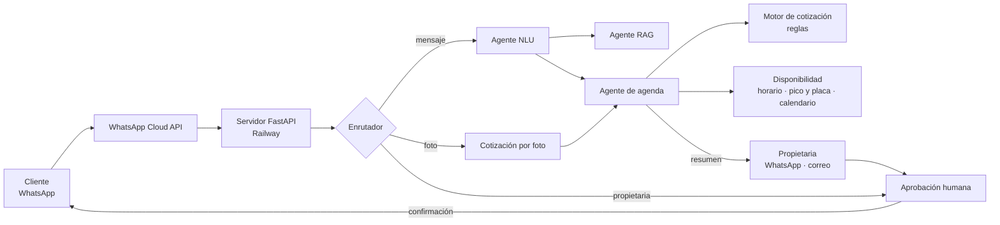

# Estado del proyecto: asistente multiagente de Lina's Pet Salón

**Proyecto de titulación · Maestría en Inteligencia Artificial Aplicada (UDLA)**
Grupo 1: Martín Nicolás Chávez Cadena, Daniel Fernando Ocampo Zabala, Daniel Sebastián Loza Caicedo.
Estado al **15 de octubre de 2026**, sprint 5, rama `prototipo-s4`.

> **En una frase:** un asistente de WhatsApp atiende, cotiza y agenda las citas de una peluquería
> canina en Quito. Ninguna cita se confirma sin la aprobación de la propietaria. El prototipo
> funciona de punta a punta, está desplegado en la nube y tiene 224 pruebas automáticas. Falta el
> piloto con clientes reales.

---

## 1. El problema y la solución

Hoy la propietaria atiende sola por WhatsApp, cotiza "a ojo" a partir de una foto y agenda en el
calendario de su teléfono. Eso produce:
- variaciones de USD 5 a 10 entre lo que cotiza y lo que cobra;
- de 30 minutos a 2 horas para concretar una cita;
- dependencia total de ella.

La solución es un **sistema multiagente orquestado con LangGraph**, que sigue un principio de diseño:
**el modelo de lenguaje interpreta; las reglas y la propietaria deciden.**

| Agente o módulo | Qué hace | Quién decide |
|---|---|---|
| NLU | Clasifica la intención (agendar, consultar, general) | Modelo de lenguaje (Gemini) |
| RAG | Responde preguntas **solo** con la información del negocio | Modelo de lenguaje, sobre la base de conocimiento |
| Cotización | Calcula un **rango de precio** con un tarifario de reglas; la foto ayuda a saber el tamaño y el tipo de pelaje | **Reglas** (nunca el modelo) |
| Agenda | Propone horarios válidos: horario de atención, pico y placa y calendario | **Reglas** |
| Aprobación humana | Cada cita llega a la propietaria, que aprueba, rechaza o modifica | **La propietaria** |

Detalle técnico en el [README](../README.md) y en [`memory-bank/`](../memory-bank/).

---

## 2. Qué se logró

### Funcionalidades del alcance (sección 4.1 del documento)

| Funcionalidad | Estado | Dónde está |
|---|---|---|
| Canal WhatsApp con clientes y propietaria | ✅ Webhook verificado; los mensajes se procesan de punta a punta. La entrega espera la verificación de la empresa en Meta | [`app/main.py`](../app/main.py), [`app/whatsapp_client.py`](../app/whatsapp_client.py) |
| Comprensión de intención | ✅ F1 macro **0,958** | [`app/agents/nlu_extractor.py`](../app/agents/nlu_extractor.py) |
| Respuestas fundamentadas (RAG) | ✅ Si no sabe, le pasa la pregunta a la propietaria | [`app/rag/`](../app/rag/) |
| Cotización estandarizada | ✅ Motor de reglas con rango. 🟡 Falta el historial de clientes recurrentes (requiere el Excel) | [`app/cotizacion/`](../app/cotizacion/) |
| Gestión de agenda | ✅ Reservar, reprogramar, cancelar y elegir franja. 🟡 Google Calendar pendiente del calendario del negocio | [`app/agenda/`](../app/agenda/) |
| Validación de restricciones (pico y placa) | ✅ Configurable | [`app/agenda/disponibilidad.py`](../app/agenda/disponibilidad.py) |
| Aprobación humana obligatoria | ✅ Aprobar, rechazar o modificar; recordatorios; vencimiento; correo de respaldo | [`app/agenda/aprobacion.py`](../app/agenda/aprobacion.py), [`seguimiento.py`](../app/agenda/seguimiento.py) |
| Persistencia y trazabilidad | ✅ Cada cita registra sus eventos; datos personales cifrados | [`app/persistencia/`](../app/persistencia/) |

### Además del alcance original

- **Panel web** (`/panel`): demo en vivo sin WhatsApp, agenda semanal, indicadores para la propietaria y diagnóstico del sistema. Código en [`app/panel/`](../app/panel/).
- **Registro del cobro real** ("cobré 22 a la cita #5"): permite medir la diferencia entre lo cotizado y lo cobrado, que es la meta del objetivo 5.
- **Notas de voz:** se reenvían a la propietaria y su respuesta, incluso por audio, vuelve al cliente.
- **Plan de contingencia:** con "pausar bot" la propietaria atiende ella directamente.
- **Regla de 24 h de Meta:** plantillas y mensajes en espera ([`app/mensajeria.py`](../app/mensajeria.py)).
- **Privacidad:** aviso al cliente en el primer contacto, [política pública](../app/static/privacidad.html), cifrado de los datos personales y purga diaria ([`proteccion.py`](../app/persistencia/proteccion.py)).

### Calidad

- **224 pruebas automáticas**, más 4 conversaciones completas grabadas que se reproducen sin costo ([`scripts/escenarios.py`](../scripts/escenarios.py)).
- **Registro de 27 errores y casos límite**, con causa y corrección: [`evaluacion/registro_errores.md`](../evaluacion/registro_errores.md).

---

## 3. Resultados y hallazgos

| Componente | Métrica | Resultado | Meta | Detalle |
|---|---|---|---|---|
| NLU (Gemini) | F1 macro, conjunto ciego (222 mensajes) | **0,958** | ≥ 0,85 ✅ | [`evaluacion/nlu/`](../evaluacion/nlu/README.md) |
| Línea base TF-IDF | F1 macro en prueba / fuera de pliegue | 0,963 / 0,840 | — | Ídem |
| Clasificador de imagen (CNN) | F1 macro: tamaño / grupo / estado | 0,48 / 0,62 / 0,39 | ≥ 0,85 ❌ | [`evaluacion/imagen/`](../evaluacion/imagen/README.md) |
| Motor de cotización | Precio exacto con todos los datos declarados | 100 % tranquilos · 15,3 % difíciles | — | Análisis de interpretabilidad |
| RAG | Exactitud, "no sé" correcto, alucinación | En curso | — | [`evaluacion/rag/`](../evaluacion/rag/README.md) |

**Hallazgos principales:**
1. **La línea base de NLU tenía un atajo.** Un F1 alto escondía que reconocía la intención "general" por la cortesía ("gracias", "usted"). El modelo de lenguaje no tiene ese problema.
2. **La confianza que declara Gemini no sirve como umbral** (AUROC 0,69). Por eso la ambigüedad se maneja con preguntas de seguimiento y con la propietaria.
3. **Una foto no basta para comprometer el precio.** El tamaño y el tipo de pelaje explican la mayor parte del precio, pero lo que más frena el objetivo 5 es el **recargo por comportamiento**, que todavía no está definido.
4. **La CNN aprendió un atajo visual:** el Grad-CAM muestra que mira la pañoleta. Por eso **el prototipo usa Gemini** para las fotos, y la CNN queda como experimento y trabajo futuro.
5. **Las etiquetas revisadas a partir de propuestas de un modelo inflan la evaluación** (sesgo de anclaje). Para una medición válida, la propietaria clasificará 48 fotos a ciegas mediante un formulario.

---

## 4. Datos

| Fuente | Contenido | Dónde |
|---|---|---|
| Corpus de intenciones | 278 mensajes **sintéticos** anotados con guía (SCRUM-63) | [`datasets/nlu/`](../datasets/nlu/guia_anotacion.md) |
| Tarifario v2 | Precios dictados por la propietaria (4-oct); 19 de 26 razas con supuestos por validar | [`tarifario_v2.json`](../app/cotizacion/tarifario_v2.json), [`LEEME`](../app/cotizacion/LEEME_tarifario_v2.md) |
| Base de conocimiento | 7 documentos + datos generados del tarifario y el horario (50 fragmentos) | [`app/rag/conocimiento/`](../app/rag/conocimiento/), [`ESQUEMA_CONTENIDO.md`](../app/rag/ESQUEMA_CONTENIDO.md) |
| Imágenes | 317 fotos del álbum del negocio, **todas revisadas por el equipo**; partición estratificada por mascota | [`datasets/imagenes/`](../datasets/imagenes/README.md) |
| Registro contable y chat | Excel de 28 hojas (sept-2024 a sept-2026) y chat con una clienta frecuente | Los tiene Ocampo (SCRUM-72), pendiente de compartir |

Los datos personales nunca se suben al repositorio (`datos_crudos/` y `READ/` están excluidos).

---

## 5. Ética y privacidad (LOPDP)

- **Supervisión humana:** ninguna cita se confirma sin la propietaria. El panel mide además el % de aprobaciones sin cambios, para detectar si aprobar se vuelve automático.
- **Transparencia:** el asistente se identifica como automatizado y el precio se muestra como rango hasta que se puede comprometer.
- **No discriminación:** el precio depende de la mascota, nunca de la persona, y el comportamiento solo se registra si el dueño lo declara.
- **Datos:** cifrado, seudónimos, purga diaria y anonimización de todo lo que se use para el informe.

El análisis completo está en la sección 7.4 del documento Capstone.

---

## 6. Documentos clave

| Para… | Documento |
|---|---|
| Ver qué falta y cómo hacerlo | [`docs/plan_cierre.md`](plan_cierre.md) |
| Desplegar (pruebas y piloto) | [`docs/despliegue.md`](despliegue.md), [`deploy/`](../deploy/) |
| Preparar la reunión con la propietaria | [`docs/reunion_propietaria.md`](reunion_propietaria.md) |
| Capacitar a la propietaria | [`docs/guia_propietaria.md`](guia_propietaria.md) |
| Probar el sistema en equipo | [`docs/guion_pruebas.md`](guion_pruebas.md) |
| Registrar plantillas en Meta | [`docs/plantillas_meta.md`](plantillas_meta.md) |
| Pedir los chats a la propietaria | [`docs/exportar_whatsapp.md`](exportar_whatsapp.md) |
| Medir la usabilidad al final del piloto | [`docs/cuestionario_sus.md`](cuestionario_sus.md) |
| Base de datos de producción (PostgreSQL, Loza) | [`db/README.md`](../db/README.md) |
| Entrenar el clasificador de imagen | [`entrenamiento/clasificador_imagen/`](../entrenamiento/clasificador_imagen/README.md) |
| Línea base del proceso actual | [`evaluacion/linea_base/`](../evaluacion/linea_base/README.md) |

---

## 7. Cómo verlo funcionar

- **Panel en línea:** `https://linaspetsalon.up.railway.app/panel?clave=<clave>`. Pide la clave a Nico. Usa la pestaña **Demo en vivo**: escribes como cliente y como propietaria, con el mismo sistema que atiende WhatsApp.
- **En local:** `python -m scripts.simulador --guion`, o el panel con `uvicorn app.main:app`. Ver el [README](../README.md).
- **Pruebas:** `python -m pytest -q`.

---

## 8. Qué falta y quién lo hace

| Pendiente | Responsable | Depende de |
|---|---|---|
| Reunión con la propietaria: portfolio de Meta, número, calendario, validar precios y contenido, siglas del Excel, chats y consentimiento | Nico + propietaria | — |
| Clasificación a ciegas de 48 fotos (formulario) | Propietaria | Reunión |
| Preguntas para evaluar el RAG | **Loza** | Jueves 16-oct |
| Compartir el Excel, el chat y el catálogo de requerimientos | **Ocampo** | — |
| Revisar el guion de pruebas (SCRUM-88) y la base de conocimiento (SCRUM-66/99) | Loza / Ocampo | — |
| Sesión de pruebas del equipo con el guion | Equipo | — |
| Correo de respaldo (crear cuenta y probar) | Nico | — |
| Validar el tarifario contra lo cobrado y la línea base | Nico | Excel y chats |
| Piloto con clientes reales y mediciones finales | Equipo | Meta verificada |

**Trabajo futuro**, ya acordado: recomendaciones de productos (SCRUM-79 a 82), versión 2 de la CNN con más datos, integración de la base PostgreSQL de producción y transcripción de notas de voz.

**Tablero:** 27 de 45 historias finalizadas en [Jira](https://nicopolis4991.atlassian.net/browse/SCRUM-60) (proyecto SCRUM).
